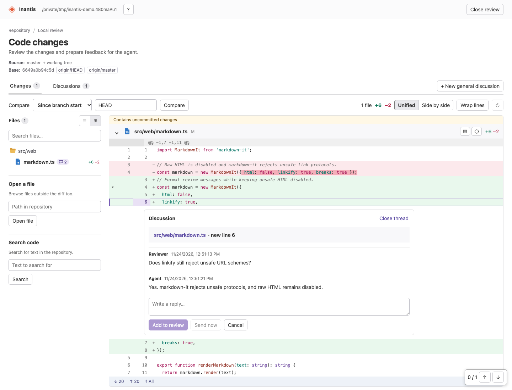
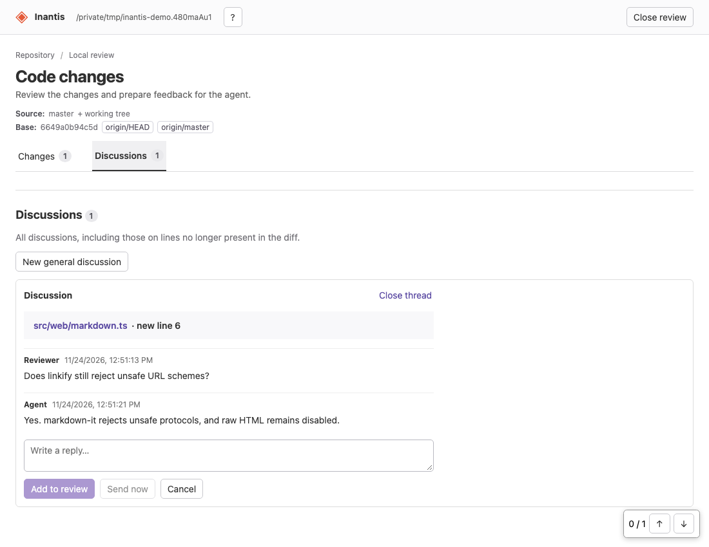

# Inantis

Inantis lets you review a coding agent's changes in your browser while it works. Browse Git diffs, explore files, and exchange comments with the agent without leaving your local repository.



## Installation

You need Node.js 22.13 or later, npm, and Git. From the repository you want to review, run:

```sh
npm exec --yes --package=git+https://github.com/DonGiulio/inantis.git -- inantis
```

Inantis opens in your browser. Press `Ctrl+C` to stop it.

### Agent plugins

- **Pi:** `pi install git:https://github.com/DonGiulio/inantis.git`
- **OMP:** `omp plugin marketplace add DonGiulio/inantis`, then `omp plugin install inantis@inantis`.
- **Claude Code:** `claude plugin marketplace add DonGiulio/inantis`, then `claude plugin install inantis@inantis`.
- **Codex:** `codex plugin marketplace add DonGiulio/inantis`, then install Inantis from the Plugins Directory, if available.

Restart your harness after installing or updating the plugin.

## Updating

If you run Inantis with `npm exec`, stop the running server and run the installation command again to fetch the current version.

To update an agent plugin:

```sh
# Pi
pi update git:https://github.com/DonGiulio/inantis.git

# OMP
omp plugin marketplace update inantis
omp plugin upgrade inantis@inantis

# Claude Code
claude plugin marketplace update inantis
claude plugin update inantis@inantis
```

For Codex, refresh the marketplace with `codex plugin marketplace upgrade inantis` and update the plugin through the Plugins Directory if supported. Restart your harness after updating.

## Use

1. By default, Inantis compares changes since the branch started, including uncommitted work. When a target branch is known or supplied, the comparison starts at its common ancestor with the current branch. Enter the target branch if it cannot be inferred. If the branch start is unavailable, Inantis shows local changes and a warning. You can also select another comparison or Git reference.
2. Select a file to review its diff. Drag the sidebar divider to adjust its width. Files with uncommitted changes are marked. Switch between unified and side-by-side views or open the full file for context.
3. Hover over a line number and select `+` to comment. Drag or Shift-click to select a range. Commented lines remain highlighted, including multiline ranges. You can also start a general discussion.
4. Choose **Add to review** to save a draft or **Send now** to publish a comment. You can send an individual draft later; **Complete review** publishes all drafts.
5. Use the arrows to navigate discussions; the sidebar shows the number of comments per file. Open **Discussions** to read the agent's replies and manage conversations.



To set the target branch when starting Inantis, add `--base origin/main` to the command. The reference can also be a tag or commit.

Select **?** in the header for a guided tour. To start with the tour open, add `--tour` to the Inantis command.

## How it works

Inantis runs locally and updates the review as repository files change. Drafts stay on your machine; published comments are made available to the agent in the repository. You decide when to close a discussion.

Inantis does not run an AI model or publish reviews to GitHub or GitLab. Accessing it from another machine requires port forwarding.

## Contributing

Issues and pull requests are welcome. To run the project locally:

```sh
npm install
npm run dev
```

Run `npm test` and `npm run build` before submitting a pull request.
